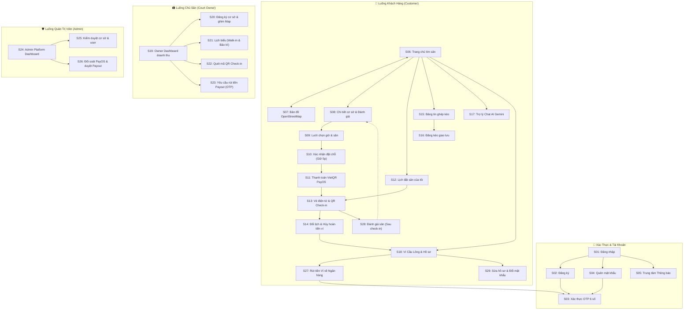

# 🏸 Badminton Court Hub V2 — Nền Tảng Quản Lý, Đặt Sân & Tìm Kèo Cầu Lông

> **Đồ án môn PRM393 — Ứng dụng Di động Đa Nền tảng**  
> Kiến trúc: **Flutter Mobile (Frontend)** + **Java Spring Boot 3 (REST API Backend)** + **SQLite Database (WAL Mode)**  
> Quy mô: **3 Roles**, **5 Luồng nghiệp vụ**, **29 Màn hình (`S01` -> `S29`)**, **6 Module kỹ thuật bắt buộc** và **21 sân cầu lông thực tế quanh Làng Đại Học Quốc Gia TP.HCM**.

---

## 📑 Mục Lục
1. [Công Nghệ Sử Dụng (Tech Stack)](#1-công-nghệ-sử-dụng-tech-stack)
2. [Cấu Trúc Thư Mục Dự Án](#2-cấu-trúc-thư-mục-dự-án)
3. [Hướng Dẫn Cài Đặt & Chạy Cho Thành Viên Nhóm](#3-hướng-dẫn-cài-đặt--chạy-cho-thành-viên-nhóm)
4. [Tài Khoản Demo & Phân Quyền (3 Roles)](#4-tài-khoản-demo--phân-quyền-3-roles)
5. [Dữ Liệu Demo: 21 Sân Cầu Lông Quanh Làng Đại Học (NVHSV)](#5-dữ-liệu-demo-21-sân-cầu-lông-quanh-làng-đại-học-nvhsv)
6. [Kịch Bản 6 Module Kỹ Thuật (Checklist PRM393)](#6-kịch-bản-6-module-kỹ-thuật-checklist-prm393)
7. [Bản Đồ 29 Màn Hình (`S01` -> `S29`) & 5 Luồng Nghiệp Vụ](#7-bản-đồ-29-màn-hình-s01---s29--5-luồng-nghiệp-vụ)
8. [Kiểm Thử & Đảm Bảo Chất Lượng (Quality Assurance)](#8-kiểm-thử--đảm-bảo-chất-lượng-quality-assurance)

---

## 1. Công Nghệ Sử Dụng (Tech Stack)

### Mobile Frontend (Flutter)
- **Framework**: Flutter 3.x (Dart 3.x), Material 3 Design System.
- **Responsive & Adaptive Layout**: Hỗ trợ toàn diện từ điện thoại nhỏ (360x640), màn hình ngang (landscape), tablet (800x1280) đến desktop (≥1024px). Chuyển đổi tự động `BottomNavigationBar` (Mobile) sang `NavigationRail` (Tablet/Desktop).
- **Bản đồ**: `flutter_map` (OpenStreetMap / Leaflet) + `latlong2`, định vị GPS, vẽ lộ trình và tính khoảng cách theo công thức Haversine.
- **Thanh toán & Mã vạch**: `qr_flutter` tạo và quét mã VietQR PayOS / QR Check-in vé.
- **State Management**: Reactive `AppState` (`ChangeNotifier`) kết nối REST API Spring Boot và tự động đồng bộ thời gian thực.

### Backend REST API (Java Spring Boot)
- **Framework**: Spring Boot 3.4.2 (Java 17/21/24), Spring Data JPA, Hibernate ORM 6.6.
- **Database**: SQLite JDBC (chế độ **WAL Mode - Write-Ahead Logging**) giúp đọc/ghi đồng thời cực nhanh, không lo xung đột file.
- **API Documentation**: SpringDoc OpenAPI 3 / Swagger UI (`/swagger-ui/index.html`).
- **Tự động Seeding**: `DataSeeder.java` tự động nạp 4 User, 21 sân cầu lông thật quanh Làng ĐH, các cụm sân `Court`, bảng giá `PricingRule`, vé đặt, trận đấu và ví tiền ngay khi khởi động.
- **Tác vụ nền**: `BookingHoldScheduler` tự động quét và giải phóng các ô sân giữ chỗ quá 5 phút chưa thanh toán.

---

## 2. Cấu Trúc Thư Mục Dự Án

```text
d:\badminton_v2\
├── .gitignore                          # Root Gitignore (chặn .env, database, build nặng; cho phép đẩy ảnh assets)
├── README.md                           # Tài liệu dự án đầy đủ
│
├── backend\                            # Java Spring Boot 3 Backend
│   ├── .gitignore                      # Chặn target/, *.class, *.db, application-secret.properties
│   ├── pom.xml                         # Cấu hình Maven dependencies (Spring Boot, SQLite, OpenAPI, Lombok...)
│   ├── badminton_v2.db                 # File SQLite Database (tự sinh khi chạy)
│   └── src\main\
│       ├── resources\
│       │   └── application.yml         # Cấu hình SQLite WAL mode, Hibernate DDL, logging
│       └── java\com\badminton\v2\
│           ├── BadmintonV2Application.java
│           ├── config\
│           │   ├── AppConfig.java      # Cấu hình CORS, PasswordEncoder, RestTemplate
│           │   ├── DataSeeder.java     # Tự động nạp 21 sân Làng ĐH, Users, Bookings, Matches
│           │   └── OpenApiConfig.java   # Cấu hình Swagger UI / OpenAPI 3
│           ├── entity\                 # 13 JPA Entities (User, Venue, Court, Booking, Payment...)
│           ├── repository\             # 13 Spring Data JPA Repositories
│           ├── service\                # EmailOtpService, NotificationService, BookingHoldScheduler
│           └── controller\             # 7 REST Controllers (/api/auth, /api/venues, /api/bookings...)
│
└── mobile\                             # Flutter Mobile App
    ├── .gitignore                      # Chặn build/, .dart_tool/, android/.gradle, local.properties
    ├── pubspec.yaml                    # flutter_map, latlong2, qr_flutter, http, intl...
    ├── test\
    │   └── widget_test.dart            # Bộ test Responsive 29 màn hình trên 4 kích thước (360x640, 640x360, 800x1280, 1280x800)
    └── lib\
        ├── main.dart                   # Điểm khởi chạy app & thiết lập MaterialApp
        ├── app\                        # Shell ứng dụng & điều hướng trung tâm
        │   ├── app_shell.dart          # Khung Scaffold, AppBar, Adaptive NavRail/BottomBar
        │   ├── app_navigation.dart     # Điều hướng theo vai trò (Customer / Owner / Admin)
        │   ├── app_drawer.dart         # Menu Drawer chuyển nhanh 29 screens khi demo PRM393
        │   ├── app_theme.dart          # Material 3 Theme (Emerald #059669, typography Barlow)
        │   └── screen_registry.dart    # Ánh xạ mã S01-S29 sang widget tương ứng
        ├── core\                       # Tiện ích dùng chung & State
        │   ├── api_service.dart        # HTTP Client tự động nhận diện IP Android/Web/Desktop
        │   ├── app_state.dart          # State trung tâm 3 vai trò, đồng bộ với Spring Boot API
        │   ├── responsive.dart         # Hệ thống Breakpoints, LayoutBuilder & ResponsiveCenter
        │   ├── ui_kit.dart             # StatusBadge, BottomActionBar, InfoPill, UiFmt, UiDate
        │   └── booking_rules.dart      # Quy tắc nghiệp vụ giữ chỗ, đổi lịch & hoàn tiền
        └── screens\                    # 29 Màn hình được phân cụm chuyên biệt
            ├── screens.dart            # Export tập trung toàn bộ màn hình
            ├── auth\                   # S01 (Login), S02 (Register), S03 (OTP), S04 (Forgot PW)
            ├── shared\                 # S05 (Trung tâm thông báo thời gian thực)
            ├── customer\               # S06 -> S18, S27, S28, S29 (Khách hàng: Tìm sân, Map, Đặt sân, VietQR, Ví, Kèo, AI, Rút tiền, Đánh giá, Sửa hồ sơ)
            ├── owner\                  # S19 -> S23 (Chủ sân: Dashboard, Ghim Map, Lịch biểu, Quét QR, Payout)
            └── admin\                  # S24 -> S26 (Quản trị: Dashboard, Kiểm duyệt sân, Đối soát giải ngân)
```

---

## 3. Hướng Dẫn Cài Đặt & Chạy Cho Thành Viên Nhóm

### Yêu cầu môi trường
- **Java**: JDK 17 trở lên (đã kiểm thử tương thích tốt với JDK 17, 21, 24).
- **Maven**: 3.8+ (hoặc dùng `mvn` có sẵn trong PATH).
- **Flutter SDK**: 3.22+ (kênh stable) & Dart 3.4+.

### Bước 1: Khởi động Backend (Spring Boot + SQLite)
Mở cửa sổ dòng lệnh thứ nhất:
```powershell
cd d:\badminton_v2\backend
mvn clean compile
mvn spring-boot:run
```
- Backend khởi động tại: `http://localhost:8080`.
- Tài liệu API tương tác Swagger UI: `http://localhost:8080/swagger-ui/index.html`.
- *File cơ sở dữ liệu `badminton_v2.db` sẽ được `DataSeeder.java` tự động khởi tạo và nạp sẵn 21 sân cùng dữ liệu mẫu.*

### Bước 2: Khởi động Mobile (Flutter)
Mở cửa sổ dòng lệnh thứ hai:
```powershell
cd d:\badminton_v2\mobile
flutter pub get
flutter run
```
- Có thể chọn thiết bị chạy: Chrome (`-d chrome`), Máy ảo Android (`-d android`), hoặc Windows Desktop (`-d windows`).

---

## 4. Tài Khoản Demo & Phân Quyền (3 Roles)

Hệ thống cấu hình sẵn 3 tài khoản đại diện cho 3 phân quyền. Mật khẩu chung: **`123456`**, mã OTP chung: **`123456`**.

| Phân quyền (Role) | Email Đăng Nhập | Mật Khẩu | Màn Hình Chính | Mô Tả Quyền Hạn |
| :--- | :--- | :---: | :---: | :--- |
| **👤 Customer (Người chơi)** | `customer@badminton.vn` | `123456` | **`S06`** | Tìm sân, xem map, đặt sân qua VietQR PayOS, quản lý vé QR check-in, đổi/hủy vé vào ví, tìm kèo & chat AI Gemini. |
| **🏟️ Court Owner (Chủ sân)** | `owner@badminton.vn` | `123456` | **`S19`** | Xem doanh thu/công suất, đăng ký cơ sở ghim tọa độ map, quản lý lịch biểu (khách vãng lai, bảo trì), quét mã QR check-in, yêu cầu rút tiền Payout. |
| **🛡️ Admin (Quản trị viên)** | `admin@badminton.vn` | `123456` | **`S24`** | Thống kê toàn sàn, kiểm duyệt hồ sơ sân mới, giám sát đối soát giao dịch PayOS và phê duyệt lệnh giải ngân Payout. |

> 💡 **Phục vụ Thuyết trình PRM393:**
> - Tại màn hình đăng nhập `S01`: Có sẵn **3 nút chuyển nhanh Role** (`Khách hàng` / `Chủ sân` / `Quản trị`) để vào app ngay mà không cần gõ phím.
> - Trên thanh `AppBar`: Có nút mở **Menu Drawer danh mục 29 màn hình** để chuyển thẳng tới bất kỳ màn hình nào theo yêu cầu của Giảng viên.

---

## 5. Dữ Liệu Demo: 21 Sân Cầu Lông Quanh Làng Đại Học (NVHSV)

Vị trí neo GPS người dùng: **Nhà Văn Hóa Sinh Viên ĐHQG TP.HCM** (`10.8753° N, 106.8000° E`).  
Tất cả các sân đều có thông tin thật, tọa độ GPS thực tế và hình ảnh chất lượng cao:

| STT | Tên Sân | Địa Chỉ | Khoảng Cách | Quy Mô | Bảng Giá (Thường - Giờ vàng) |
| :---: | :--- | :--- | :---: | :---: | :---: |
| **1** | **Sân CLB TDTT ĐH Thể Dục Thể Thao** | Khuôn viên ĐH TDTT, KP.6, P. Linh Trung, Thủ Đức | **0.8 km** | 6 sân | 60.000đ - 100.000đ/h |
| **2** | **Sân Cầu Lông TPT Sport Làng ĐH** | Đường A2, Khu đô thị ĐHQG TP.HCM, Dĩ An | **1.0 km** | 8 sân | 65.000đ - 110.000đ/h |
| **3** | **Sân Cầu Lông ĐH Nông Lâm TP.HCM** | Khuôn viên ĐH Nông Lâm, KP.6, Linh Trung, Thủ Đức | **1.3 km** | 5 sân | 55.000đ - 90.000đ/h |
| **4** | **Sân Cầu Lông KTX Khu B ĐHQG** | Đường Mạc Đĩnh Chi, KTX Khu B ĐHQG, Dĩ An | **2.1 km** | 6 sân | 50.000đ - 90.000đ/h |
| **5** | **Sân Cầu Lông Ao An (Bình An)** | 22/8 ĐT743A, KP. Nội Hóa 1, Bình An, Dĩ An | **1.9 km** | 6 sân | 55.000đ - 95.000đ/h |
| **6** | **Sân Cầu Lông Aurora Sport Linh Trung** | 129 Đường số 7, P. Linh Trung, Thủ Đức | **2.2 km** | 7 sân | 70.000đ - 110.000đ/h |
| **7** | **Sân Cầu Lông Lan Anh Linh Trung** | 119 Đường số 7, P. Linh Trung, Thủ Đức | **2.5 km** | 6 sân | 65.000đ - 105.000đ/h |
| **8** | **Sân Cầu Lông Đông Hòa Dĩ An** | 122 Trần Hưng Đạo, P. Đông Hòa, TP. Dĩ An | **2.0 km** | 8 sân | 60.000đ - 100.000đ/h |
| **9** | **Sân Cầu Lông Gia Hân Dĩ An** | 80 Võ Thị Sáu, P. Đông Hòa, TP. Dĩ An | **2.4 km** | 15 sân | 50.000đ - 90.000đ/h |
| **10** | **Sân Cầu Lông TH Badminton** | 166 Võ Thị Sáu, KP. Tây A, Đông Hòa, Dĩ An | **2.8 km** | 8 sân | 60.000đ - 110.000đ/h |
| **11** | **Sân Cầu Lông HL Sport Dĩ An** | 52 Nguyễn Trãi, TP. Dĩ An, Bình Dương | **2.9 km** | 6 sân | 60.000đ - 100.000đ/h |
| **12** | **Sân Cầu Lông Hải Anh Linh Xuân** | 82 Đường số 5, KP.2, P. Linh Xuân, Thủ Đức | **3.0 km** | 6 sân | 60.000đ - 100.000đ/h |
| **13** | **Sân Cầu Lông Đồng Giao Linh Xuân** | 12 Đường số 11, P. Linh Xuân, Thủ Đức | **3.4 km** | 6 sân | 65.000đ - 105.000đ/h |
| **14** | **Sân Cầu Lông 68 Linh Xuân** | 68 Đường số 8, P. Linh Xuân, Thủ Đức | **3.5 km** | 7 sân | 60.000đ - 100.000đ/h |
| **15** | **Sân Cầu Lông Thảo Nguyên** | 22 Đường số 9, P. Linh Trung, Thủ Đức | **2.7 km** | 6 sân | 65.000đ - 110.000đ/h |
| **16** | **Sân Cầu Lông SHB Badminton** | 127 Lê Văn Chí, P. Linh Trung, Thủ Đức | **3.6 km** | 12 sân | 65.000đ - 120.000đ/h |
| **17** | **Sân Cầu Lông Lan Phương** | 15 Đường số 2, KP.4, Linh Trung, Thủ Đức | **4.0 km** | 8 sân | 60.000đ - 105.000đ/h |
| **18** | **Sân Cầu Lông UTE (ĐH SP Kỹ Thuật)** | 1 Võ Văn Ngân, P. Linh Chiểu, Thủ Đức | **4.2 km** | 6 sân | 60.000đ - 100.000đ/h |
| **19** | **Sân Cầu Lông Rạng Đông** | 7B Bác Ái, P. Bình Thọ, Thủ Đức | **4.6 km** | 8 sân | 70.000đ - 120.000đ/h |
| **20** | **Sân Cầu Lông An Bình Dĩ An** | 18 An Bình, P. An Bình, TP. Dĩ An | **4.6 km** | 6 sân | 55.000đ - 95.000đ/h |
| **21** | **Sân TH Badminton CS2 (Chờ duyệt)** | Số 10 Đường Vành Đai ĐHQG, Dĩ An | **1.5 km** | 6 sân | 60.000đ - 100.000đ/h |

---

## 6. Kịch Bản 6 Module Kỹ Thuật (Checklist PRM393)

1. **Module 1: Cơ Sở Dữ Liệu & REST API**
   - File cơ sở dữ liệu SQLite `badminton_v2.db` vận hành ở chế độ **WAL mode** qua Spring Data JPA với 13 thực thể (`User`, `Venue`, `Court`, `PricingRule`, `Booking`, `Payment`, `Refund`, `WalletTransaction`, `PayoutRequest`, `MatchPost`, `MatchParticipant`, `NotificationItem`, `OtpToken`).
   - Cung cấp đầy đủ REST API CRUD và các endpoint nghiệp vụ tại `com.badminton.v2.controller`.

2. **Module 2: Bản Đồ Tương Tác (OpenStreetMap)**
   - **`S07` (Khách hàng)**: Bản đồ tương tác định vị GPS của người dùng tại Nhà Văn Hóa Sinh Viên, ghim 21 sân cầu lông kèm giá tiền và khoảng cách thực tế; chọn sân bất kỳ để tự động vẽ tuyến đường (`Polyline`) nối tới sân.
   - **`S20` (Chủ sân)**: Chạm trực tiếp lên bản đồ để lấy tọa độ kinh độ/vĩ độ chính xác cho cơ sở mới.

3. **Module 3: Cổng Thanh Toán Trực Tuyến (PayOS VietQR) & Vé Điện Tử**
   - **`S09` -> `S10` -> `S11`**: Khóa ô sân `HELD` 5 phút chống đặt trùng (Race Condition) -> Sinh mã VietQR PayOS động -> Mô phỏng Webhook thành công -> Chuyển vé sang `CONFIRMED` và tạo mã QR check-in tại **`S13`**.
   - **`S14` & `S18`**: Nghiệp vụ hủy vé tự động tính tỷ lệ hoàn tiền theo chính sách (100% trước 24h, 50% trước 12h) và cộng tức thì vào **Ví Cầu Lông nội bộ**.
   - **`S27` (Mới)**: Rút tiền từ Ví Cầu Lông về tài khoản ngân hàng (nhập số tiền, số tài khoản, ngân hàng thụ hưởng) và liên kết xác thực OTP bảo mật.
   - **`S28` (Mới)**: Đánh giá cơ sở sân sau khi hoàn thành / check-in vé (xếp hạng 1-5 sao, chọn tags nhanh, nhận xét thực tế) và đồng bộ trực tiếp lên trang chi tiết sân `S08`.

4. **Module 4: Xác Thực & Bảo Mật Tài Khoản (Mã OTP 6 Chữ Số)**
   - Hệ thống phát sinh mã OTP 6 số ngẫu nhiên có hiệu lực 5 phút gửi qua `EmailOtpService` phục vụ cho:
     - Đăng ký tài khoản mới (`S02` -> `S03`).
     - Đặt lại mật khẩu (`S04` -> `S03`).
     - Rút tiền từ Ví Cầu Lông của người chơi (`S27` -> `S03`).
     - Cập nhật hồ sơ & đổi mật khẩu tài khoản (`S29`).
     - Xác nhận lệnh rút tiền Payout của Chủ sân (`S23`).

5. **Module 5: Trung Tâm Thông Báo (Real-Time Notification)**
   - Màn hình **`S05`** lưu trữ và cập nhật tức thì các biến động: thanh toán thành công, hoàn tiền ví, rút tiền ví thành công, có người tham gia kèo giao lưu, phê duyệt cơ sở.
   - Thanh `AppBar` hiển thị Badge đếm số lượng thông báo chưa đọc.

6. **Module 6: Trợ Lý Ảo Chat AI Thông Minh**
   - Màn hình **`S17`** kết nối backend `/api/ai/chat`, nạp ngữ cảnh dữ liệu sân bãi thực tế từ SQLite (tình trạng sân trống, mức giá sinh viên, các kèo đang mở, chính sách hoàn vé) và tự sinh các nút tắt điều hướng nhanh trong tin nhắn.

---

## 7. Bản Đồ 29 Màn Hình (`S01` -> `S29`) & 5 Luồng Nghiệp Vụ

### Sơ đồ điều hướng tổng thể (Mermaid Flowchart)



### Bảng Danh Mục Chi Tiết 29 Màn Hình (`S01` — `S29`)

| Mã | Tên Màn Hình | Nhóm Phân Quyền | Tính Năng & Luồng Nghiệp Vụ Chính |
| :---: | :--- | :---: | :--- |
| **`S01`** | **Đăng nhập (Login)** | Xác thực | Đăng nhập tài khoản, ghi nhớ mật khẩu, nút chọn nhanh 3 vai trò demo (Customer/Owner/Admin). |
| **`S02`** | **Đăng ký (Register)** | Xác thực | Đăng ký người dùng mới, chọn trình độ ban đầu, chuyển tiếp sang xác thực OTP. |
| **`S03`** | **Xác thực OTP (OTP Verification)** | Xác thực | Nhập mã 6 số OTP (mặc định demo: `123456`), xử lý đăng ký, quên mật khẩu, rút tiền ví & payout. |
| **`S04`** | **Quên mật khẩu (Forgot Password)** | Xác thực | Nhập email nhận mã khôi phục tài khoản, đặt lại mật khẩu mới. |
| **`S05`** | **Trung tâm Thông báo (Notifications)** | Dùng chung | Thông báo biến động số dư ví, đặt sân thành công, duyệt tham gia kèo, duyệt sân mới. |
| **`S06`** | **Trang chủ Tìm sân (Customer Home)** | Người chơi | Tìm kiếm, lọc sân theo giá/khoảng cách/khu vực quanh Làng ĐH, xem các sân nổi bật. |
| **`S07`** | **Bản đồ Sân (Map Discovery)** | Người chơi | Bản đồ tương tác OpenStreetMap, ghim 21 sân thật quanh KTX & NVHSV, vẽ lộ trình và tính khoảng cách GPS. |
| **`S08`** | **Chi tiết Cơ sở (Venue Detail)** | Người chơi | Thông tin sân, danh sách cụm sân, tiện ích, bảng giá theo khung giờ và mục đánh giá từ người chơi. |
| **`S09`** | **Lưới Chọn giờ & Sân (Time Slot Grid)** | Người chơi | Lưới trực quan theo thời gian thực: chọn sân con, giờ chơi thường/giờ vàng, loại trừ ô đã đặt/bảo trì. |
| **`S10`** | **Xác nhận Đặt sân (Checkout)** | Người chơi | Tóm tắt đơn hàng, áp dụng cơ chế giữ chỗ 5 phút (`HELD`), chọn cổng VietQR PayOS hoặc Ví. |
| **`S11`** | **Thanh toán VietQR PayOS (Payment QR)** | Người chơi | Hiển thị mã QR VietQR chuẩn NAPAS 247, đồng hồ đếm ngược 5 phút, nút giả lập Webhook thành công. |
| **`S12`** | **Lịch Đặt sân Của Tôi (My Bookings)** | Người chơi | Quản lý danh sách vé: Đã xác nhận (`CONFIRMED`), Chờ thanh toán, Hoàn thành, Đã hủy. |
| **`S13`** | **Chi tiết Vé & Mã QR Check-in (Ticket Detail)** | Người chơi | Chi tiết đặt sân, sinh mã QR check-in tại sân, nút chuyển Đổi lịch / Hủy vé / Đánh giá sân (`S28`). |
| **`S14`** | **Hủy vé & Đổi lịch (Cancel / Reschedule)** | Người chơi | Tự động tính tỷ lệ hoàn tiền theo chính sách (100% ≥24h, 50% 6-24h), hoàn tiền tức thì vào Ví. |
| **`S15`** | **Bảng tin Ghép kèo (Matchmaking Feed)** | Người chơi | Mạng xã hội thể thao: xem danh sách các kèo mở quanh Làng ĐH, lọc theo trình độ, xin tham gia/duyệt thành viên. |
| **`S16`** | **Đăng tin Mở kèo (Create Match Post)** | Người chơi | Tạo kèo mới: chọn sân, ngày giờ, trình độ yêu cầu (Cơ bản -> Chuyên nghiệp), chi phí chia sẻ. |
| **`S17`** | **Trợ lý Ảo AI Gemini (AI Assistant Chat)** | Người chơi | Chatbot AI tư vấn thông minh, phân tích dữ liệu sân thật, gợi ý kèo đấu và hỗ trợ điều hướng nhanh. |
| **`S18`** | **Ví Cầu Lông & Hồ sơ (Profile & Wallet)** | Người chơi | Hiển thị số dư ví, lịch sử biến động số dư, thông tin cá nhân, lối tắt Rút tiền (`S27`) & Sửa hồ sơ (`S29`). |
| **`S19`** | **Tổng quan Doanh thu Chủ sân (Owner Dashboard)**| Chủ sân | Dashboard theo dõi doanh thu thực nhận, công suất sân, số lượt đặt online và số dư chờ giải ngân. |
| **`S20`** | **Đăng ký & Ghim Tọa độ Sân (Venue Registration)**| Chủ sân | Form tạo cơ sở sân mới: nhập địa chỉ, số sân, chạm bản đồ lấy tọa độ GPS chính xác, gửi duyệt. |
| **`S21`** | **Lịch biểu & Khách vãng lai (Slot Management)** | Chủ sân | Quản lý sơ đồ sân: khóa bảo trì, tạo vé cho khách vãng lai (walk-in) chống chồng chéo lịch online. |
| **`S22`** | **Quét mã QR Check-in (Owner QR Scanner)** | Chủ sân | Quét mã QR vé của người chơi tại quầy lễ tân để đối soát và kích hoạt trạng thái `CHECKED_IN`. |
| **`S23`** | **Yêu cầu Giải ngân Payout (Owner Payout)** | Chủ sân | Đối soát doanh thu trừ hoa hồng sàn 5%, tạo lệnh rút tiền về tài khoản ngân hàng (xác thực OTP). |
| **`S24`** | **Tổng quan Sàn Admin (Admin Dashboard)** | Quản trị | Thống kê toàn hệ thống: tổng người dùng, tổng cơ sở, tổng GMV và dòng tiền đối soát sàn. |
| **`S25`** | **Kiểm duyệt Sân & Cơ sở (Admin Approval)** | Quản trị | Xem xét hồ sơ sân mới từ Chủ sân (địa chỉ, GPS, hình ảnh), phê duyệt kích hoạt hoặc từ chối. |
| **`S26`** | **Đối soát & Duyệt Giải ngân (Admin Payout Audit)**| Quản trị | Danh sách yêu cầu rút tiền Payout của các chủ sân, kiểm tra giao dịch PayOS và phê duyệt giải ngân. |
| **`S27`** | **Rút tiền Ví Cầu Lông (Wallet Withdraw)** ⭐ *Mới* | Người chơi | Rút số dư ví về tài khoản ngân hàng cá nhân (tối thiểu 50.000đ), liên kết luồng xác thực OTP `S03`. |
| **`S28`** | **Đánh giá & Phản hồi Sân (Venue Review)** ⭐ *Mới* | Người chơi | Đánh giá sao (1-5★), gắn tags (sân đẹp, ánh sáng tốt, vệ sinh sạch), viết cảm nghĩ sau trận đấu. |
| **`S29`** | **Sửa Hồ sơ & Đổi Mật khẩu (Edit Profile)** ⭐ *Mới* | Người chơi | Cập nhật họ tên, số điện thoại, trình độ cầu lông kỹ thuật và tính năng đổi mật khẩu tài khoản. |

---

## 8. Kiểm Thử & Đảm Bảo Chất Lượng (Quality Assurance)

Dự án được cấu hình và kiểm thử tự động đạt tiêu chuẩn 100% trước khi nộp đồ án:

1. **Phân tích tĩnh Flutter (`flutter analyze`)**:
   ```bash
   cd mobile
   flutter analyze
   ```
   *Kết quả: `No issues found!` (0 errors, 0 warnings).*

2. **Kiểm thử Responsive toàn bộ 29 màn hình (`flutter test`)**:
   ```bash
   cd mobile
   flutter test
   ```
   *Chạy tự động kiểm tra hiện tượng tràn pixel (overflow) của 29 màn hình trên 4 cấu hình kích thước thiết bị:*
   - Điện thoại nhỏ: `360 x 640` (Small Phone Portrait) — **PASS (0 overflow)**
   - Màn hình xoay ngang: `640 x 360` (Phone Landscape) — **PASS (0 overflow)**
   - Máy tính bảng: `800 x 1280` (Tablet Portrait) — **PASS (0 overflow)**
   - Web / Desktop / Tablet xoay ngang: `1280 x 800` — **PASS (0 overflow)**

3. **Kiểm thử tích hợp Backend (`mvn test`)**:
   ```bash
   cd backend
   mvn test
   ```
   *Kết quả: `BUILD SUCCESS` (Kiểm tra Spring Context, khởi tạo SQLite WAL, nạp DataSeeder, tự động xử lý HELD scheduler).*
